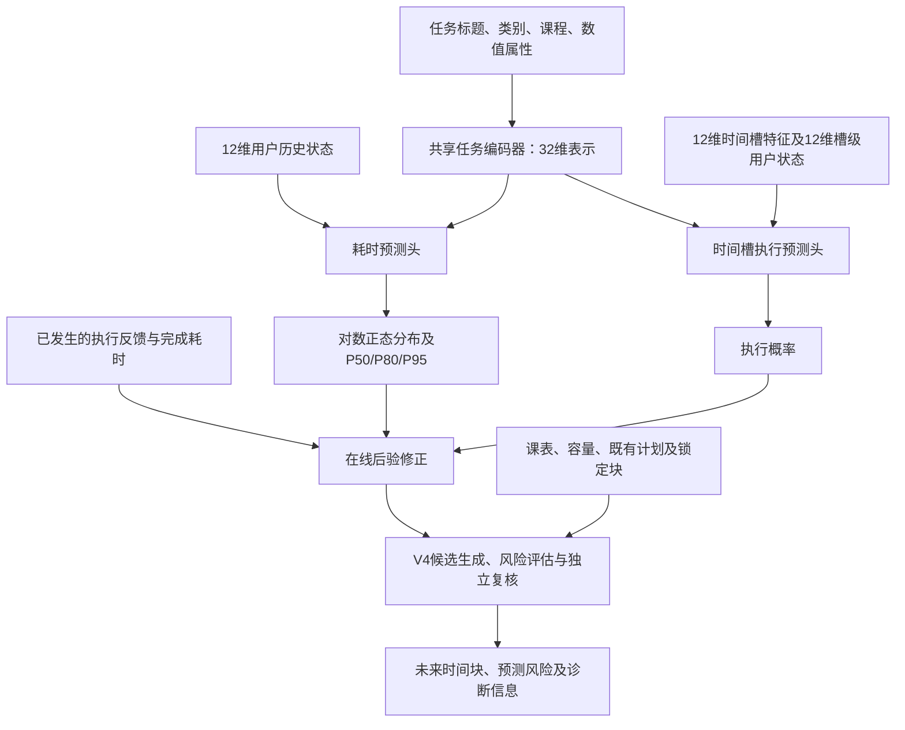

# ChronoFlow-DRP 模型技术总结

整理日期：2026-10-18。本文以当前 `model/` 中的实现为准，主规划方法为 **V4 Integrated / `drp_full`，optimizer revision 1，online version 1**；网络及部署元数据版本为 `0.1.0`。`model-final/` 是另一份交付目录，本文不将其中历史配置混入当前主方法。

## 1. 模型定位与整体流程

ChronoFlow-DRP 面向学习任务的个性化日程安排，处理任务耗时不确定、不同时间段执行意愿不同，以及重排频繁扰动已有计划的问题。完整系统由三层组成：

1. **多任务预测网络**：共享任务表示，同时预测任务耗时分布和候选时间槽的执行概率。
2. **轻量在线个性化**：利用已经发生的执行反馈、已完成任务耗时修正预测，保持全局网络权重冻结。
3. **风险感知滚动规划**：在课表、可用时间、每日容量、冻结及锁定承诺约束下，比较有限候选计划，兼顾完成风险和计划稳定性。



网络输出概率和分布参数，具体日程由确定性代码生成。当前实现是**有限候选的 CVaR 启发式规划**，没有分布鲁棒优化所需的歧义集合，也没有全局最优性证明。

## 2. 数据与特征实现

### 2.1 训练样本与监督标签

适配后的 JSONL 每行对应一个任务，包含任务属性、耗时标签、用户状态及可变数量的时间槽样本。`TaskDataset` 编码特征，`collate_tasks` 对槽数补齐，并用掩码排除补齐位置和缺失标签。

| 监督对象 | 标签 | 实现口径 |
|---|---|---|
| 任务耗时 | `actual_work_minutes` | 有可靠实际耗时才参加耗时损失 |
| 时间槽执行 | `COMPLETED`、`PARTIALLY_COMPLETED` → 1 | 表示发生执行，不等于整个任务完成 |
| 时间槽未执行 | `SKIPPED`、`DELAYED` → 0 | 明确负反馈 |
| 未知反馈 | `UNKNOWN` 或未观察 → `null` | 损失和指标均排除，不当作失败 |
| 未选中候选方案的块 | 排除 | 不能将反事实候选当作真实执行监督 |

### 2.2 输入特征

| 输入 | 维度或规模 | 编码方式 |
|---|---:|---|
| 任务标题 `hashed_text` | 2048 | NFKC 规范化、小写、空白合并；字符 2/3-gram；FNV-1a 32位有符号哈希累加；L2 归一化 |
| 任务类别 `category_id` | 8类 → 16维 | 可学习 Embedding |
| 课程 `course_id` | 512桶 → 16维 | 稳定哈希后查可学习 Embedding |
| 任务数值属性 `numeric_features` | 16 | 固定缩放、截断和指示变量 |
| 耗时头用户状态 `user_state` | 12 | 预测时刻之前的用户历史 |
| 时间槽属性 `slot_features` | 每槽12维 | 时段、星期、时长、负荷及期限信息 |
| 槽级用户状态 `slot_user_state` | 每槽12维 | 每个槽预测时刻对应的历史状态 |

16维任务数值属性的固定顺序为：难度、优先级、对数初始估时、距截止时间、已发布时长、最早开始延迟、可拆分标记、子任务数、有无截止时间、有无最早开始时间、短任务标记、长任务标记、24小时内截止标记、72小时内截止标记、两个预留零位。难度除以5，优先级除以10；估时使用 `log1p(minutes)/log1p(20160)`；期限距离按14天缩放。

12维用户状态依次为：近7日完成率、已完成块数、跳过块数、延后块数、实际/计划耗时比、实际工作分钟、计划工作分钟、积压任务数、逾期任务数、平均估时误差、平均开始延迟、连续工作分钟。适配器采用固定缩放；平均估时误差使用 `tanh`；缺失历史使用全零向量。

12维时间槽特征依次为：上午/下午/晚上/夜间四维 one-hot、星期正弦、星期余弦、计划时长、此前当日负荷、此前连续工作时长、距截止时间、任务已发布时长、所用耗时分位数。缺失截止时间编码为“无期限压力”，不编码为“立即截止”。

### 2.3 时间因果与划分

- 用户日状态仅取预测日期**之前**的最近记录，避免当天事后汇总泄漏。
- 适配器拦截任务预测早于发布、计划生成早于任务发布的数据。
- `sim_*` 等模拟真值不进入预测特征。
- 预测器按用户留出：42名训练用户、9名验证用户、9名测试用户。
- 另设30个语义族留出；相关任务从训练/验证视图移出，写入 `semantic_test.jsonl`。测试用户的语义留出任务同时保留在用户测试集中，因此两种测试并非完全不重叠。
- 规划回放另按场景 ID 的 SHA256 固定划分约60%/20%/20%，与预测器的用户划分独立。

### 2.4 本地数据规模与来源口径

以下为现有 `dataset/splits.json` 与 `dataset-audit.json` 的记录，属于原始多表统计，不是适配后的最终训练样本量；本次未重新运行全量数据审计。

| 项目 | 数量 |
|---|---:|
| 用户 | 60 |
| 任务 | 5,099 |
| 有耗时标签的任务 | 4,135 |
| 全部候选时间块 | 23,053 |
| 实际被选入快照的块 | 7,615 |
| 用户日记录 | 1,680 |
| 计划快照 / Pareto选择记录 | 各1,678 |
| 重排记录 | 721 |
| 固定时间区间 | 3,586 |
| 场景头 / 完整场景实例 | 10,000 / 2,000 |
| 原始任务训练 / 验证 / 测试划分 | 3,603 / 737 / 759 |
| 语义留出任务 | 753 |

**来源记录存在差异**：数据 README、`splits.json` 和审计文件标注为模拟数据；较新的评估 README 记载“项目负责人确认主数据的任务文本和实际耗时来自真实测量”，同时保留原始 simulated 标记，执行概率来源尚待单独说明。本文保留这一差异，不据此自行认定全部数据的来源。不同方法的执行过程由回放器模拟，不能将回放结果写成多方法真实用户试验。

## 3. 神经网络结构

### 3.1 共享任务编码器

默认结构如下，激活函数为 SiLU，隐藏层 Dropout 为0.1：

```text
标题哈希 2048 ── Linear(2048,128) + SiLU ── 128
类别ID ───────── Embedding(8,16) ─────────── 16
课程桶ID ─────── Embedding(512,16) ───────── 16
任务数值属性 ─────────────────────────────── 16
                         拼接 → 176
Linear(176,256) → SiLU → Dropout(0.1)
Linear(256,64)  → SiLU → Dropout(0.1)
Linear(64,32)  → 任务表示 z
```

编码器采用字符哈希与小型 MLP，不依赖预训练语言模型。共享表示让耗时与执行监督共同训练任务编码器；用户状态在两个预测头中输入。

### 3.2 耗时分布预测头

输入为32维任务表示和12维用户状态：`44 → 64 → 2`。中间使用 SiLU 和 Dropout，输出原始值转换为：

\[
\log T\sim\mathcal N(\mu,\sigma^2),\qquad
\sigma=\min\{2.0,\operatorname{softplus}(r_\sigma)+0.08\}.
\]

其中 \(T\) 是以分钟计的实际工作耗时，\(\mu\) 是对数分钟的均值参数。分位数直接计算：

\[
Q_q=\exp\{\mu+\Phi^{-1}(q)\sigma\}.
\]

因此 P50 为 \(e^\mu\)，P80 为 \(e^{\mu+0.841621\sigma}\)，P95 为 \(e^{\mu+1.644854\sigma}\)。P50 是中位数，分布均值为 \(e^{\mu+\sigma^2/2}\)。规划包装层还对参数和分位数施加数值边界。

### 3.3 执行概率预测头

对每个候选槽，拼接任务表示32维、槽级用户状态12维、槽属性12维，经过 `56 → 64 → 1` 得到 logit；Sigmoid 后得到执行概率：

\[
p_{i,s}=\operatorname{sigmoid}(g(z_i,u_{i,s},x_{i,s})).
\]

同一批任务可有不同数量的候选槽。批大小为 \(B\)、补齐后槽数为 \(S\) 时，两个输出分别为 `[B,2]` 和 `[B,S]`。

按默认层宽及偏置计算，网络共有 **341,155个可训练参数**，约34.1万；该数字是由当前结构推算的参数量，不是实测推理速度。

## 4. 损失函数与训练

### 4.1 多任务目标

耗时头使用带掩码的对数正态负对数似然：

\[
\ell_T(t)=\log t+\log\sigma+\tfrac12\log(2\pi)
+\frac{(\log t-\mu)^2}{2\sigma^2}.
\]

训练实现将目标耗时下限设为1分钟，避免对数数值问题。执行头使用 `binary_cross_entropy_with_logits`：

\[
\ell_E(y,p)=-y\log p-(1-y)\log(1-p),\qquad
\mathcal L=\lambda_T\mathcal L_T+\lambda_E\mathcal L_E.
\]

两个损失分别在其有效标签上取均值，默认权重均为1。未知执行标签、补齐槽和缺失耗时不参与损失；没有有效标签时返回可反向传播的零损失。训练入口未启用额外类别重加权。

### 4.2 默认训练配置

| 参数 | 当前默认值 |
|---|---:|
| 优化器 | AdamW |
| 学习率 / 权重衰减 | 0.001 / 0.0001 |
| Batch size | 64 |
| 最大 epoch | 80 |
| 早停耐心 | 连续10轮验证总损失未改善 |
| 梯度范数裁剪 | 5.0 |
| 随机种子 | 20261017 |
| 最优检查点 | `chronoflow_best.pt` |

训练集打乱，验证集不打乱；根据验证集总损失保存最佳模型及优化器状态、epoch、版本和验证指标。当前 epoch 汇总对各 batch 的损失等权平均，不是对全数据有效标签数加权的全局均值。详细预测性能应使用专门评估入口重新统计。

这些是代码默认配置，不能仅凭配置断言已有权重实际训练了80轮；本地部署元数据未记录最佳 epoch 或完整训练日志。

## 5. 在线个性化

### 5.1 当前回放与部署共用的修正规则

全局网络保持冻结，使用当前策略已经观察到的历史更新：

- **时段执行率修正**：每个时段累计成功次数 \(s_b\) 与尝试次数 \(n_b\)，将网络概率 \(p_b\) 作为强度为4的先验：
  \[
  p'_b=\frac{4p_b+s_b}{4+n_b}.
  \]
- **耗时修正**：对已完成任务累计对数残差 \(R=\sum_j(\log t_j-\mu_j)\)，完成任务数为 \(n\)：
  \[
  \mu'=\mu+\frac{R}{4+n}.
  \]
  保留原 \(\sigma\)，相当于对耗时尺度做有先验收缩的乘法校正。

回放中每次尝试后更新执行历史，任务完成后才更新耗时历史。端侧适配器根据当前工作空间的过去反馈和完成任务重建历史，并拒绝未来完成或未来反馈。当前场景没有真实用户身份，网络用户状态使用全零冷启动向量，槽输入采用四个时段的原型特征，尚未接入完整长期用户状态和实际候选块负荷。

### 5.2 独立个性化工具类

`src/chronoflow_model/personalization.py` 还提供另一组可复用状态类：Beta(2,2)时段后验、按类别的耗时倍率、指数平滑的12维状态及序列化。该工具中的耗时先验权重为5，部分完成可按0.5权重更新。它与当前 `Predictor` 的回放公式不是同一条调用路径，不能混写为当前 V4 的实际更新规则。

## 6. V4 风险感知滚动规划

### 6.1 时间网格和可行性

当前集成配置使用30分钟时间槽、120分钟冻结窗口、每日360分钟容量、08:00—22:00工作时段。端侧规划未来14天；回放时使用各场景自身的观察与规划窗口。

可行计划需要满足：任务已经可见且达到最早开始时间、任务块互不重叠、不与固定课表冲突、不超出规划窗口和工作时段、不超每日容量，并保持不可拆任务的连续性及冻结/锁定承诺。截止日期作为完成风险目标，不强制所有时间块必须排在截止前；容量不足时可能产生逾期或未完成任务。

### 6.2 候选搜索与目标函数

V4 首先调用内部参考搜索 `improved_plan`：

1. 生成初始估时 EDF、保留旧计划后补空等候选。
2. 扫描耗时 P50/P80/P95，组合 EDF 与优先级/松弛量顺序，并生成时段偏好候选。
3. 为可拆任务增加执行率缓冲候选，避免将不可拆任务按低执行率无限放大。
4. 对候选进行硬约束及冻结检查，去除重复块集合。
5. 通过预测分布抽样模拟执行，评估完成风险、剩余工作和响应延迟。

冷启动时同时考虑模型分布与初始估时先验，模型情景的比例为：

\[
w(n)=0.5+0.5\frac{n}{n+8}.
\]

其中 \(n\) 为已完成耗时反馈数。先验为初始估时对应的对数正态分布，\(\sigma=0.35\)，执行率为0.75。代码在采样场景间分层选择两类分布，不直接平均两组损失来压低尾部风险。

单次抽样的组合损失为：

\[
L(\pi,\omega)=D(\pi,\omega)+0.15U(\pi,\omega)+0.10R(\pi,\omega),
\]

其中 \(D\) 是窗口内到期任务的优先级加权未按时完成比例，\(U\) 是优先级加权剩余工作比例，\(R\) 是从当前决策时刻到完成或窗口末尾的归一化加权延迟。参考搜索的主目标与总评分为：

\[
J_{\rm primary}=\mathbb E[L]+0.5\operatorname{CVaR}_{0.9}(L),\qquad
J=J_{\rm primary}+0.15S.
\]

\(S\) 是计划扰动成本除以 `max(30, 当前任务初始估时总和)`。先保留主目标不超过最佳值0.02的候选，再按总评分选择，限制稳定性目标对完成风险的牺牲。

### 6.3 局部修复、保留与独立复核

集成层将内部参考计划作为比较基准，审计保留旧计划的可行性，按新任务、缺少安排任务、紧迫任务和受影响任务排序，尝试修复1、2、4项任务及必要时全部任务；通过条件的候选优先减少扰动。

候选必须在预测截止损失均值、截止损失CVaR、加权完成损失和响应延迟上通过 guard。均值比较使用配对差值近似上界：

\[
\bar\Delta+1.645\frac{s_\Delta}{\sqrt N}\leq\epsilon,
\]

当前各容差 \(\epsilon\) 均为0。尾部损失直接比较经验CVaR差值。参考候选搜索、集成筛选、最终复核使用分开的样本编号；最终复核失败，直接返回参考计划，不在复核样本上重新搜索。

`planning_samples=16`，当前三阶段分别使用编号0—15、16—31、32—47。该配置应优先于 `base.json` 中参考规划参数 `scenario_count=64` 来理解当前 V4 回放。

配置中的 `enable_local_repair`、`enable_replan_cooldown`、`enable_low_gain_rejection` 为已退役实验开关，当前均为 false，运行器拒绝打开它们。集成层自身仍实现上述局部候选修复；不能仅看开关名称推断没有修复逻辑，也不能将未启用的冷却机制写成当前功能。

这些保护是基于有限预测样本的经验复核，不保证真实执行中每次重排都会改善。

## 7. 预测层评估指标

详细指标由 `scripts/evaluate_predictor.py` 生成；`scripts/evaluate.py` 仅报告训练同口径的损失。耗时指标排除缺失目标，执行指标排除未知标签和补齐位置。

### 7.1 耗时预测

令真实耗时为 \(t_i\)，预测中位数为 \(\hat t_i=Q_{0.5,i}\)。

| 指标 / 输出字段 | 定义与解释 | 方向 |
|---|---|---|
| MAE / `mae_minutes` | \(N^{-1}\sum_i|\hat t_i-t_i|\)，单位分钟 | 越小越好 |
| 中位绝对误差 / `median_absolute_error` | 绝对误差的中位数，单位分钟 | 越小越好 |
| sMAPE / `smape` | 平均 \(2|\hat t-t|/(\hat t+t)\)，输出范围0—2，未乘100 | 越小越好 |
| NLL / `nll` | 对数正态负对数似然均值，评价整条预测分布 | 越小越好 |
| CRPS / `crps_minutes` | \(\int(F(x)-\mathbf1[x\ge t])^2dx\) 的均值，代码使用对数正态闭式，单位分钟 | 越小越好 |
| 分位覆盖率 / `coverage_0.5/0.8/0.95` | 实际耗时不超过对应预测分位数的比例 | 接近0.5/0.8/0.95 |
| 覆盖误差 / `coverage_error_*` | 实际覆盖率与目标分位数的绝对差 | 越小越好 |
| 90%区间宽度 / `interval90_width` | 平均 \(Q_{0.95}-Q_{0.05}\)，单位分钟 | 结合校准解释 |

区间过窄可能意味着低估不确定性，因此不能单独以宽度越小判断模型越好。当前未单独输出90%中心区间的实际覆盖率。

### 7.2 时间槽执行概率

| 指标 / 输出字段 | 定义与解释 | 方向 |
|---|---|---|
| BCE / `bce` | 二分类对数损失 | 越小越好 |
| Brier / `brier` | 平均 \((p-y)^2\) | 越小越好 |
| AUROC / `auroc` | 以“执行”为正类的排序能力，并列概率使用平均秩 | 越大越好 |
| 风险AP / `risk_average_precision` | 以“未执行”为正类，风险分数为 \(1-p\) 的Average Precision | 越大越好 |
| 未执行召回 / `nonexecution_recall` | 真实未执行样本中，预测 \(p<0.5\) 的比例 | 越大越好 |
| F1 / `f1` | 以“执行”为正类、\(p\ge0.5\) 为预测执行的F1 | 越大越好 |
| ECE / `ece` | 10个等宽概率桶内预测均值与实际执行率之差的加权绝对值 | 越小越好 |
| `n` / `positive_rate` | 有效样本数 / 实际执行比例 | 解释辅助量 |

只有单一类别时 AUROC 为 `null`；没有未执行样本时，风险AP和未执行召回为 `null`。不能把这些缺失值解释成0分。

### 7.3 预测基线

同一评估入口提供：训练集耗时全局中位数、训练集拟合的单一对数正态分布、训练集总体执行率，以及固定0.5执行概率。所有需估计的基线统计量只从 `--train-data` 计算。用户留出与语义留出分别评估。

## 8. 日程规划评估

### 8.1 统一回放与八种方法

`evaluation/run_evaluation.py` 读取 `dataset/scenario_instances.jsonl`，将所有方法放入同一离散事件环境；各方法共享容量、时间网格、可行性约束、冻结规则和执行语义。

| 方法 | 耗时与执行信息 | 决策目标或作用 |
|---|---|---|
| `edf` | 用户初始估时 | 最早截止优先 |
| `priority_edf` | 用户初始估时 | 优先级与松弛量排序 |
| `deterministic` | 学习P50；评估执行率固定为1 | 单点预测规划 |
| `probabilistic` | 学习耗时分布；固定总体执行率先验0.75 | 期望损失 |
| `global_probability` | 冻结网络的耗时和执行概率 | 期望损失与时段概率，无在线更新 |
| `personalized` | 同上，加过去反馈的在线修正 | 检查短期个性化收益 |
| `risk_aware` | 同上 | 期望损失 + CVaR |
| `drp_full` | V4集成预测、先验混合、在线更新 | 风险、稳定性、修复与复核 |

这是主方法加7个基线。V4还包含不同的候选搜索、组合损失和保护规则，因此 `risk_aware → drp_full` 的差异不能严格归因于“只增加稳定性项”。

回放通过 `SHA256(scenario_id, seed, task_id, minute)` 构造共同潜在执行随机场，避免方法调用顺序改变潜在结果。真值耗时和执行概率仅模拟器可见，规划器只接收已可见任务、公开约束、已观察进度及历史。

失败尝试同样占用一个30分钟槽及每日容量；可拆任务保留进度，不可拆任务中断后重新开始。新任务达到 `prediction_at` 后才可见，可执行起点按网格向后取整。

### 8.2 核心效果指标

令 \(H\) 为观察窗口末尾，\(r_i\) 为发布时间，\(d_i\) 为截止时间，\(c_i\) 为完成时间，\(w_i\) 为优先级；\(E\) 为窗口结束前可获知任务集合，\(D\subseteq E\) 为窗口内到期任务集合。未完成任务的截断完成时刻按 \(H\) 处理。

| 指标 / 输出字段 | 实现定义 | 方向 |
|---|---|---|
| 加权按时完成率 / `weighted_ontime_rate` | \(\sum_{i\in D}w_i\mathbf1(c_i\le d_i)/\sum_{i\in D}w_i\) | ↑ |
| 完成率 / `completion_rate` | \(|\{i\in E:i已完成\}|/|E|\)，不按优先级加权 | ↑ |
| 截止损失 / `deadline_loss` | 有到期任务时为1−加权按时完成率 | ↓ |
| 尾部截止损失 / `cvar_deadline_loss` | 跨场景与种子的截止损失最坏10%概率质量均值 | ↓ |
| 截断观察延迟 / `restricted_latency_minutes` | 对所有 \(i\in E\) 平均 \(\min(c_i,H)-r_i\) | ↓ |
| 归一化截断延迟 / `normalized_restricted_latency` | 平均 \([\min(c_i,H)-r_i]/\max(1,H-r_i)\) | ↓ |
| 首次开始延迟 / `first_start_delay_minutes` | 首次成功工作时刻−发布时刻；未开始则使用 \(H-r_i\) | ↓ |
| 未完成比例 / `censored_fraction` | 观察结束仍未完成任务的比例 | ↓ |
| 剩余工作 / `unfinished_minutes` | 未完成任务真值耗时−保留进度之和；只供评估 | ↓ |
| 已完成任务逾期 / `completed_tardiness_minutes` | 窗口内到期且已完成任务的 \(\max(0,c_i-d_i)\) 均值，含按时完成的零值 | ↓ |
| 可行率 / `feasible` | 每次回放所有快照均无硬约束和冻结违规时为1，汇总取均值 | ↑ |
| 违规数 / `constraint_violations` | 各决策快照约束及冻结违规累计 | ↓ |

窗口内没有到期任务时，加权按时完成率为 `null`，截止损失按0处理。`restricted_latency` 不是 Kaplan–Meier RMST，任务随访长短不同，需结合归一化指标与删失率解释。只统计已完成任务的逾期均值容易受选择偏差影响，不能替代全任务指标。

### 8.3 稳定性与计算成本

`disruption_minutes` 按任务匹配新旧块，对移动的起止时刻、删除及新增计费；旧块距当前越近，权重越高：

\[
a(b)=1+3\exp\{-(start_b-now)/120\}.
\]

移动成本为 \(a(b)(|start_b-start'_b|+|end_b-end'_b|)\)，删除成本为 \(a(b)\times duration_b\)，新增成本为新增时长。冻结及正在执行的承诺单独审计；已完成任务移除其失效承诺不计作冻结违规。该值是加权扰动成本，不等于单纯移动的实际分钟。

计算成本报告 `planning_seconds_mean/max`；此外记录重排次数、实际计划变化次数、局部/扩展修复次数、保留计划次数、复核回退次数、任务切换数和日负荷方差等诊断量。`replans` 是规划调用次数，不等于计划实际改变次数。规划耗时是当前机器实测值，不是硬超时保证。

`predicted_cvar_reduction_mean` 比较同一可见任务集合中新旧计划的**预测**风险，仅作诊断。规划内部CVaR作用于包含剩余工作和响应项的组合损失，最终 `cvar_deadline_loss` 只作用于截止损失，两者不可混用。

### 8.4 压力场景与统计

场景包括常态、P95耗时、连续两次跳过、课表拥挤、晚间执行率下降、新紧急任务。双跳过冲击固定在场景相对起点后120和150分钟；课表缺少 `known_at`，回放假设固定课表最初已知，因此课表拥挤不表示已验证获知临时变更后的恢复能力。

报告输出总体、各压力类别及压力类别等权宏平均。方法差值按相同场景和种子配对；普通指标先在场景内平均种子，再以场景为聚类单位做2,000次 Bootstrap。尾部截止损失采用场景聚类重采样后重新计算CVaR差值。95%区间为探索性区间，未对多指标/多比较做显著性校正。

差值方向始终是 `method − baseline`：完成率正值较好，损失、延迟及扰动负值较好。默认回放种子为11；Bootstrap及规划随机种子为20261017。

`personalization_lift.json` 对比 `personalized` 与 `global_probability`，反映场景内短期反馈适配，不能等同于真实用户长期个性化效果。当前没有精确Oracle，不报告最优遗憾；虽有Pareto和三维超体积工具函数，但未形成各方法公平的扫描前沿，主评估不自动报告超体积。

## 9. 导出与端侧部署

训练使用 PyTorch；导出为 ONNX opset 17，支持动态 batch 和动态槽数。模型有7个输入：`hashed_text`、`category_id`、`course_id`、`numeric_features`、`user_state`、`slot_features`、`slot_user_state`；输出为 `duration_parameters` 和 `execution_logits`。

`validate_export.py` 在固定随机合成输入上比较 PyTorch 与 ONNX 两组输出，默认最大绝对误差阈值为 `1e-4`。这只验证数值一致性，不能代替预测性能、特征跨端一致性或真实设备验收。

当前部署目录包含已标记 `trained=true` 的 ONNX、配置、元数据及校验清单。本地权重文件为 **1,375,015字节，约1.31 MiB**，清单记录的模型 SHA256 为：

```text
7df73b81f440827ba3bbc6a2977b2769b2f9559ae53b89d31efc683caaa1eaa9
```

Android 实现将 ONNX 与规划代码随APK分发，通过 Kotlin 调用嵌入式Python规划层，神经网络由 ONNX Runtime Android CPU 执行；不在手机训练全局模型。当前网页暂未接入模型，独立Python HTTP服务作为可选工具保留。

2026-10-20 已再次通过 Android 单元测试与 Debug APK 构建。Python桥接测试使用模拟推理输出，真实设备飞行模式推理仍需按设备验收记录确认；构建成功不能据此宣称已有手机实测性能。

## 10. 复现入口与结果状态

### 10.1 常用命令

以下在 `model/` 目录执行，需要事先准备对应数据、检查点与依赖。输出使用新目录名，避免覆盖既有实验。

```powershell
# 详细预测评估：用户留出
python scripts/evaluate_predictor.py --data adapted/test.jsonl --train-data adapted/train.jsonl --checkpoint checkpoints/chronoflow_best.pt --output evaluation/results/predictor-test-summary.json

# 详细预测评估：语义留出
python scripts/evaluate_predictor.py --data adapted/semantic_test.jsonl --train-data adapted/train.jsonl --checkpoint checkpoints/chronoflow_best.pt --output evaluation/results/predictor-semantic-summary.json

# 验证集上调参，锁定配置后再运行测试集
python evaluation/run_evaluation.py --split validation --checkpoint checkpoints/chronoflow_best.pt --seeds 11 --output evaluation/results/v4-validation-summary
python evaluation/run_evaluation.py --split test --checkpoint checkpoints/chronoflow_best.pt --seeds 11 --output evaluation/results/v4-test-summary

# 不训练模型的代码测试
python -m unittest discover -s tests -v
```

不传 `--checkpoint` 的规划回放只使用先验，标记为 `UNTRAINED_PRIOR_REFERENCE`；使用 `--limit` 的结果标记为 DEBUG，均不能替代完整已训练模型测试。

正式回放产物包括 `config.json`、`manifest.json`、`runs.jsonl`、`summary.csv`、`comparisons.json`、`personalization_lift.json`、`report.md`，可选 `traces/`。Manifest 保存Git提交、数据/检查点/配置/评估代码摘要及方法假设，应随正式指标一起保存。

### 10.2 当前可支持的结论

| 项目 | 本次核对状态 |
|---|---|
| 网络、损失、训练入口、V4规划和评估指标 | 有本地实现，可按代码解释 |
| 已训练模型产物 | 部署目录有ONNX，元数据标记已训练 |
| 本地正式预测成绩 | 未找到对应正式结果文件，本文不填写数值 |
| 本地V4验证/测试成绩 | 未找到对应正式结果文件；现有README说明完整结果保存在云端 |
| 主方法优于全部基线 | 现有本地证据不足以作此结论 |
| 真实用户收益、严格DRO或最优保证 | 当前实现与回放证据不支持此类表述 |

已有评估说明还记载：部分已完成任务子集在执行概率为1的回放中，各方法完成率均为100%，因此不能声称主方法普遍领先。后续定量结论应回到原V4验证/测试结果、数据来源证据和对应manifest核验。

本次仅整理文档并核对源码、配置和已有元信息，未重新训练、运行全量回放或生成新的性能成绩。

## 11. 关键实现索引

| 内容 | 文件（相对本目录） |
|---|---|
| 模型与训练默认配置 | `config/base.json` |
| 共享编码器、双头及耗时分位数 | `src/chronoflow_model/network.py` |
| 标题哈希与任务数值特征 | `src/chronoflow_model/features.py` |
| 多表适配、用户与槽特征、标签映射 | `src/chronoflow_model/relational_adapter.py` |
| 数据加载、可变槽补齐及掩码 | `src/chronoflow_model/dataset.py` |
| NLL、BCE与多任务损失 | `src/chronoflow_model/losses.py` |
| 训练循环 / 训练入口 | `src/chronoflow_model/training.py` / `scripts/train.py` |
| 当前在线预测修正 / 回放特征 | `evaluation/predictor.py` / `evaluation/model_inputs.py` |
| V4集成 / 内部参考候选搜索 | `evaluation/integrated_planner.py` / `evaluation/improved_planner.py` |
| 主规划配置 / 基线及排程 | `evaluation/config_integrated.json` / `evaluation/planners.py` |
| 离散事件回放 / 场景读取 | `evaluation/replay.py` / `evaluation/domain.py` |
| 规划指标及Bootstrap | `evaluation/metrics.py` |
| 预测指标 / 详细预测入口 | `evaluation/prediction_metrics.py` / `scripts/evaluate_predictor.py` |
| 主评估入口及结果导出 | `evaluation/run_evaluation.py` |
| ONNX导出 / 数值一致性验证 | `scripts/export_onnx.py` / `scripts/validate_export.py` |
| 端侧数据适配 / Android推理桥接 | `deployment/planning.py` / `deployment/android.py` |
| 数据规模及历史审计 | `dataset/splits.json` / `dataset-audit.json` |
| 评估范围与结论边界 | `evaluation/README.md` |
| Android嵌入及验收说明 | `../docs/ANDROID_EMBEDDED_MODEL.md` |
